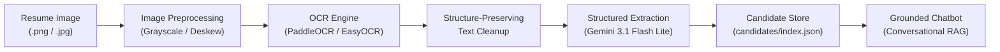

# Handwritten Resume to Searchable Candidate Information System

[](https://www.python.org/)
[]()
[](https://ai.google.dev/)
[]()

An end-to-end artificial intelligence pipeline designed to ingest handwritten and scanned resume images, extract structured digital candidate profiles adhering to strict JSON schemas, store them in a fast searchable index, and expose the candidate knowledge to an intelligent conversational chatbot guarded against hallucinations.

---

## Architecture Overview



### The 8-Stage Pipeline Design
1. **Image Ingestion:** Validates format (PNG, JPG, PDF) and loads BGR arrays with dimension checks.
2. **Preprocessing:** Grayscale conversion and conditional deskewing/contrast enhancement (tested across 13 empirical variants).
3. **OCR Recognition:** PaddleOCR (high-accuracy batch) or EasyOCR (low-latency fallback).
4. **Text Cleanup:** Regular expressions that preserve line breaks and section markers while sanitizing split email addresses.
5. **Structured Extraction:** Gemini API (`gemini-3.1-flash-lite`) enforcing strict schema output, error recovery, and OCR typo self-correction.
6. **Chunking & Embeddings:** Section-based logical partitioning (preserving degree, job, and skill blocks).
7. **Searchable Store:** Local JSON candidate registry with multi-field indexing (`candidates/index.json`).
8. **Grounded Chatbot:** Recruiter Q&A strictly constrained to verified resume facts with zero hallucination.

---

## Repository Structure

```text
├── candidates/                  # Searchable candidate database
│   ├── c_0001.json              # Extracted profile for Candidate 0001
│   ├── c_0002.json              # Extracted profile for Candidate 0002
│   └── index.json               # Fast search index (skills, companies, education)
├── images/                      # Sample resume scans & test images
│   └── image copy 3.png         # Test handwritten resume
├── report/                      # Academic & engineering reports
│   ├── Comprehensive_Handwritten_Resume_Pipeline_Report.docx  # Full 3-part report
│   └── Handwritten_Resume_Pipeline_Report.docx               # Initial design report
├── .env.example                 # Environment variables template
├── .gitignore                   # Git exclusion rules
├── OCR.py                       # 13-variant preprocessing sweep & OCR benchmark
├── model.py                     # Minimal OCR wrapper functions
├── structured_extraction.py     # Gemini structured JSON extraction module
├── chatbot.py                   # Grounded conversational candidate chatbot
├── run_pipeline.py              # End-to-end pipeline orchestrator & search CLI
├── generate_report.py           # Automated docx report builder
├── preprocessing_results.csv    # Raw benchmark data (CER, WER, Latency, Conf)
├── requirements.txt             # Project Python dependencies
└── text.txt                     # Ground truth sample text
```

---

## Quick Start & Installation

### 1. Clone & Set Up Environment

```bash
# Clone the repository
git clone https://github.com/your-username/handwritten-resume-pipeline.git
cd handwritten-resume-pipeline

# Create and activate conda environment (Python 3.10 recommended)
conda create -n py-Ai python=3.10 -y
conda activate py-Ai

# Install dependencies
pip install -r requirements.txt
```

### 2. Configure API Key

Copy the example environment file and insert your free Gemini API key:
```bash
cp .env.example .env
```
Edit `.env`:
```ini
GEMINI_API_KEY=your_gemini_api_key_here
GEMINI_MODEL=gemini-3.1-flash-lite
```

---

## How to Run

### A. Run the End-to-End Pipeline on a Resume Image
Ingest an image, run OCR, extract structured JSON, save to the registry, and launch the chatbot:
```bash
python run_pipeline.py --image "images/image copy 3.png" --id c_0003 --engine easy --chat
```

### B. Extract Structured JSON from OCR Text
Parse existing OCR text into clean, validated JSON adhering to the candidate schema:
```bash
python structured_extraction.py --input text.txt --output candidate_extracted.json
```

### C. Search the Candidate Database
Perform instant keyword and entity searches across all ingested candidates:
```bash
# Search by skill
python run_pipeline.py --search "accounting"

# Search by university
python run_pipeline.py --search "Pace University"

# Search by employer
python run_pipeline.py --search "Transamerica"
```

### D. Chat with a Candidate via Grounded Chatbot
Start an interactive terminal conversation about any stored candidate profile:
```bash
python chatbot.py --file candidates/c_0001.json
```
Or execute a single query non-interactively:
```bash
python chatbot.py --file candidates/c_0001.json --question "What degrees does Jessica hold and what were her GPAs?"
```

### E. Run the OCR Preprocessing Benchmark
Benchmark 13 preprocessing variants across PaddleOCR and EasyOCR:
```bash
python OCR.py
```
*(Outputs full CER, WER, and latency metrics to `preprocessing_results.csv`)*.

---

## Empirical Benchmark Highlights

From our 13-variant sweep on handwritten resumes:
* **Binarization Degradation:** Otsu thresholding caused Character Error Rate (CER) to jump from `0.0230` to `0.0826` on PaddleOCR and degraded Word Error Rate (WER) from `0.1585` to `0.2500` on EasyOCR. Neural OCR recognizers require continuous grayscale gradients.
* **The Confidence Fallacy:** Line confidence does not predict accuracy (Otsu reported 0.9836 confidence while CER worsened 4×).
* **Minimalist Preprocessing:** Grayscale conversion halved execution time (60.2s $\rightarrow$ 28.5s) with zero loss in recognition accuracy.

---

## Production Roadmap ('Produce')

For high-throughput, enterprise deployment:
1. **Data Privacy (Zero-Cloud PII):** Replace cloud APIs with on-premise **Ollama + Qwen 2.5 7B/14B** models to keep candidate PII completely offline.
2. **Vector Database:** Transition from local JSON files to a persistent **Qdrant** cluster with hybrid filtering (payload SQL + semantic dense vectors).
3. **Multi-Column Layouts:** Integrate **PaddleOCR PP-Structure** to prevent reading order scrambling across columns.
4. **Cursive Handwriting:** Fine-tune Vision Transformers (**TrOCR**) on the IAM Handwriting Database.

---

## Author
* **Amr Ahmed Wahidi**
* Prepared for: **Dr. Abdelrhman**
